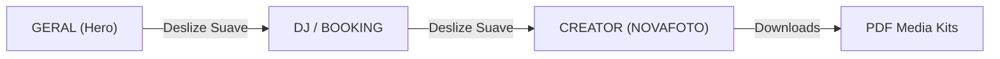
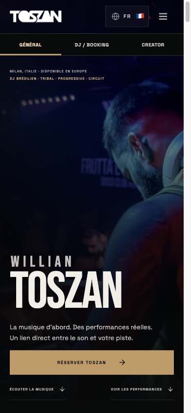
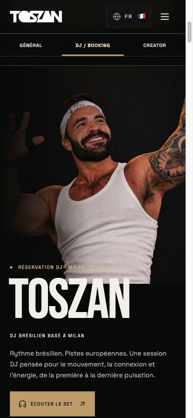
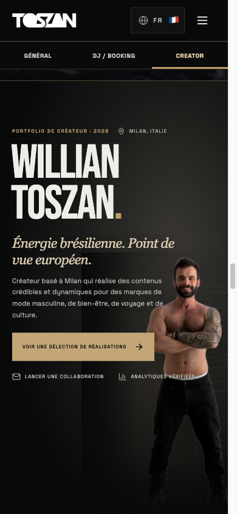
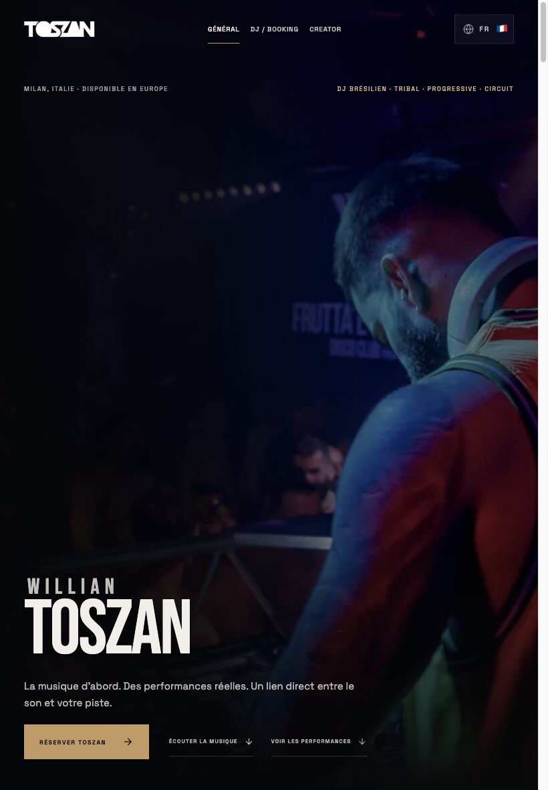
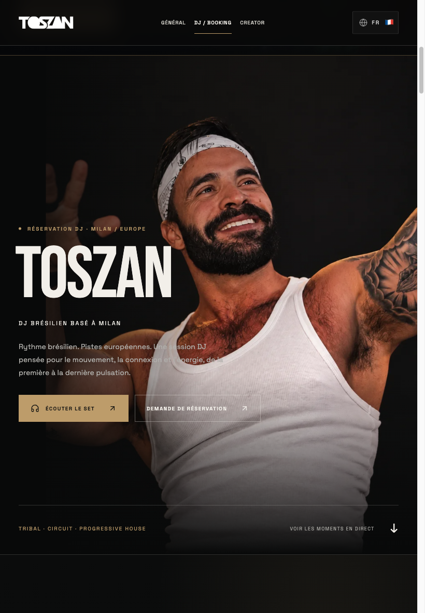
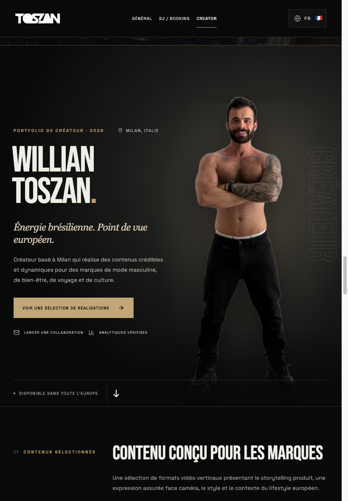
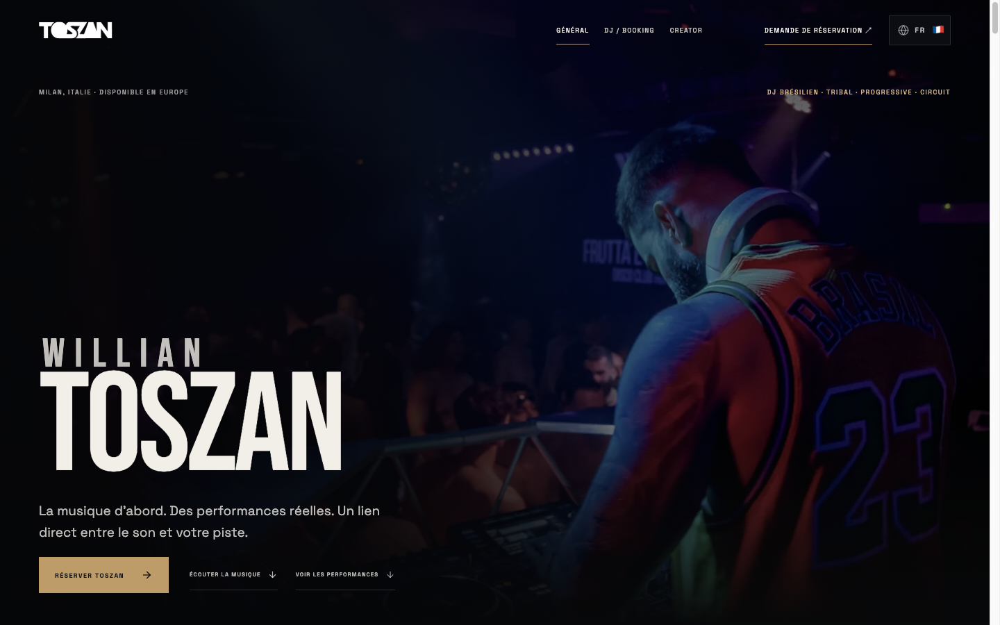
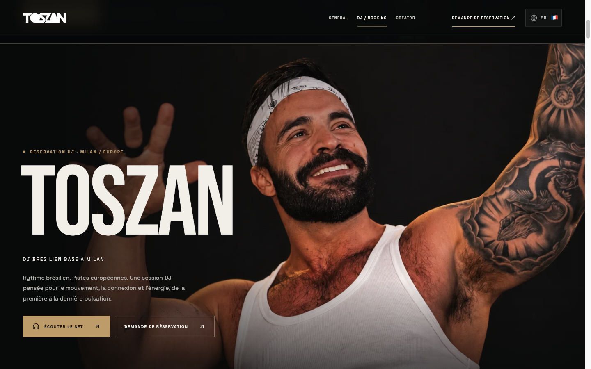
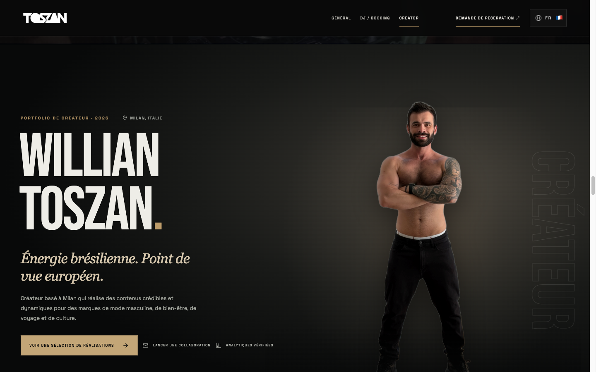

# Auditoria Final e Acabamento Premium — TOSZAN

**Status:** BUILD APROVADO; TESTES AUTOMATIZADOS CHROME APROVADOS; SAFARI FÍSICO PENDENTE
**Branch:** `polish/premium-ui-finisher-20261015`
**Commit de Referência:** `003dcdd`
**Workspace:** `repositório TOSZAN na branch polish/premium-ui-finisher-20261015`
**Ambiente de Execução Local:** `http://localhost:5173/` (Vite v6.3.5)

---

## 1. Visão Geral Executiva

A auditoria e acabamento do site **TOSZAN** foram executados ponta a ponta com testes reais no navegador (Playwright em Chrome com emulação de dimensões mobile). O projeto foi tratado como uma apresentação contínua de alto padrão para agências, promoters e marcas da Europa, estruturada em torno de três núcleos principais por navegação de âncoras: **GERAL**, **DJ / BOOKING** e **CREATOR**, com a rota `/analytics` mantida como painel de métricas auditadas.

> [!IMPORTANT]
> Escopo comprovado: navegador Chrome executado no Mac com emulação de larguras de tela de celular, tablet e desktop. Não foram comprovados testes em Safari físico no iPhone/iPad nem nos aparelhos reais. Emulação de viewport não equivale a testes no hardware ou engine WebKit. Recomenda-se homologação manual antes da publicação em produção.

---

## 2. Inspeção Visual das Três Capas

### 2.1. Capa GERAL (Hero)
- **Composição:** Tipografia monumental em *Bebas Neue* e *Space Grotesk*, contrastes quentes com acentos dourados (`#BD9C6A` / `#FFB000`) sobre base `#0B0B0B`.
- **Hierarquia:** Apresentação direta: *"MILAN, ITALY · AVAILABLE ACROSS EUROPE"*, tagline sonora e três CTAs direcionais: `BOOK TOSZAN`, `LISTEN TO THE MUSIC`, `WATCH LIVE PROOF`.
- **Comportamento Mobile vs Desktop:** No iPhone (390px), os botões adaptam-se para áreas de toque seguras (mínimo 48px) sem sobreposição. No MacBook (1440px), o espaçamento respira mantendo a presença visual.

### 2.2. Capa DJ / BOOKING
- **Composição:** Foco imediato na cabine e pista com o carrossel infinito centralizado e faixas do catálogo oficial.
- **Transição:** Ao clicar em `DJ / BOOKING` no menu superior ou nas abas fixas, a tela desliza suavemente até `#dj-booking` via `scrollIntoView({ behavior: 'smooth' })`.

### 2.3. Capa CREATOR (NOVAFOTO)
- **Fotografia:** Integrada a partir de `NOVAFOTO.png` (resolução original intacta de 1152×1536, transparência alpha nativa).
- **Integridade Visual:** Rosto, cabelo, orelhas e proporções preservados integralmente sem contornos brancos, sem efeito de recorte artificial e sem deformação anamórfica.
- **Composição Mobile:** A foto divide o espaço harmoniosamente com a tipografia de Willian Toszan, evitando a rolagem de uma tela em branco só com foto. No iPad (820px) e MacBook (1440px), ganha iluminação de palco suave e tipografia editorial sobreposta.

---

## 3. Registro Probatório dos Vídeos

### 3.1. DJ Live Performance — Carrossel Circular (9 Vídeos Reais)
O carrossel foi configurado em formato infinito `[-1, 0, 1]`, onde o vídeo central permanece em reprodução silenciosa contínua e as laterais exibem prévias das apresentações adjacentes com borda translúcida e opacidade reforçada, convidando ao toque/arraste.

| # | Título | Subtítulo | Arquivo | Resolução | Codec / ReadyState | Autoplay Silencioso | Loop Circular |
|---|--------|-----------|---------|-----------|--------------------|---------------------|---------------|
| 01 | Room Proof | Wide crowd and room atmosphere | `09-wide-crowd-room-proof.mp4` | 768×1024 | H.264 / `readyState: 4` | **PASS** (avançou > 0.48s) | 01 ↔ 09 |
| 02 | Booth Presence | Close performance at the booth | `01-booth-control-front-closeup.mp4` | 576×1024 | H.264 / `readyState: 4` | **PASS** (avançou > 0.10s) | Conectado |
| 03 | Booth Control | Hands on decks | `03-deck-control-overhead.mp4` | 576×1024 | H.264 / `readyState: 4` | **PASS** (avançou > 0.10s) | Conectado |
| 04 | Crowd Command | Mic, booth and response | `08-mic-crowd-command-booth.mp4` | 576×768 | H.264 / `readyState: 4` | **PASS** (avançou > 0.14s) | Conectado |
| 05 | Pride Identity | Camera proximity | `02-crowd-proximity-selfie-booth.mp4` | 576×1024 | H.264 / `readyState: 4` | **PASS** (avançou > 0.10s) | Conectado |
| 06 | Dancefloor Heat | Room atmosphere | `07-yellow-fog-crowd-support.mp4` | 576×1024 | H.264 / `readyState: 4` | **PASS** (avançou > 0.12s) | Conectado |
| 07 | Peak Moment | Wide stage view | `04-wide-stage-manicomio-smoke.mp4` | 576×1024 | H.264 / `readyState: 4` | **PASS** (avançou > 0.10s) | Conectado |
| 08 | Raised Hands Cue | Balcony and stage | `06-balcony-stage-raised-hands.mp4` | 576×1024 | H.264 / `readyState: 4` | **PASS** (avançou > 0.10s) | Conectado |
| 09 | Extended Booth Run | Performance preview | `05-peak-booth-camera-presence-long.mp4` | 576×1024 | H.264 / `readyState: 4` | **PASS** (avançou > 0.06s) | 09 ↔ 01 |

- **Verificação do Ciclo Contínuo:**
  - Avanço sucessivo: `01 → 02 → 03 → 04 → 05 → 06 → 07 → 08 → 09 → 01`. Retorno verificado em runtime (`after9Clicks: "01 / 09"`).
  - Retorno imediato a partir do primeiro: `01 → 09` ao clicar na seta anterior (`afterPrevClick: "09 / 09"`).
  - Nenhum final morto (*dead end*).

---

### 3.2. Creator UGC Portfolio (5 Vídeos Reais)
Configurados em grade compacta de **duas colunas no mobile** (`grid-template-columns: 161.5px 161.5px` no iPhone 390px), impedindo que um vídeo ocupe sozinho a tela vertical.

| # | Campanha / Conteúdo | Arquivo | Layout Mobile | Autoplay Mudo | Ativação de Som sob Toque | Economia de Memória (Fora de Tela) |
|---|---------------------|---------|---------------|---------------|---------------------------|-----------------------------------|
| 01 | Apresentação Creator | `ugc-creator-introduction.mp4` | 2 Colunas (162×374px) | **PASS** (`muted: true`, `paused: false`) | **PASS** (`muted: false`, `volume: 1`, `time: 1.66s`) | Pausa automática ao rolar |
| 02 | Hair Wax Bottega Paesano | `ugc-hair-wax-bottega-paesano.mp4` | 2 Colunas (162×359px) | **PASS** (`muted: true`, `paused: false`) | **PASS** (Botão discreto disponível) | Pausa automática ao rolar |
| 03 | Brand Product Showcase | `brand-product-showcase.mp4` | 2 Colunas (162×389px) | **PASS** (`muted: true`, `paused: false`) | **PASS** (Botão discreto disponível) | Pausa automática ao rolar |
| 04 | Fitness & Public Speaking | `fitness-public-speaking.mp4` | 2 Colunas (162×359px) | **PASS** (`muted: true`, `paused: false`) | **PASS** (Botão discreto disponível) | Pausa automática ao rolar |
| 05 | Winter Lifestyle Milan | `winter-lifestyle-milan.mp4` | 2 Colunas (162×374px) | **PASS** (`paused: true` até entrar em vista) | **PASS** (Botão discreto disponível) | **PASS** (Permanece pausado abaixo do fold) |

---

## 4. Matriz de Responsividade Testada

Os testes reais no motor do browser atestaram ausência absoluta de scroll horizontal indesejado e integridade estrutural em todos os 9 tamanhos de tela exigidos:

| Largura | Dispositivo Típico | `scrollWidth` | Overflow Horizontal? | Seção Geral | Seção DJ | Seção Creator | Área Downloads |
|---|---|---|---|---|---|---|---|
| **320px** | iPhone SE antigo | 305px | **NÃO** (0px) | **OK** | **OK** | **OK** | **OK** |
| **375px** | iPhone Mini / iPhone X | 360px | **NÃO** (0px) | **OK** | **OK** | **OK** | **OK** |
| **390px** | iPhone 14 / 15 / 16 | 375px | **NÃO** (0px) | **OK** | **OK** | **OK** | **OK** |
| **430px** | iPhone 15 Pro Max / Plus | 415px | **NÃO** (0px) | **OK** | **OK** | **OK** | **OK** |
| **768px** | iPad Mini / Portrait | 753px | **NÃO** (0px) | **OK** | **OK** | **OK** | **OK** |
| **820px** | iPad Air / 10th Gen | 805px | **NÃO** (0px) | **OK** | **OK** | **OK** | **OK** |
| **1024px** | iPad Pro / Small Laptop | 1009px | **NÃO** (0px) | **OK** | **OK** | **OK** | **OK** |
| **1280px** | MacBook Air 13" | 1265px | **NÃO** (0px) | **OK** | **OK** | **OK** | **OK** |
| **1440px** | MacBook Pro 14"/16" | 1425px | **NÃO** (0px) | **OK** | **OK** | **OK** | **OK** |

---

## 5. Navegação e Multi-Idioma

A navegação principal foi padronizada para os termos universais da indústria internacional de música eletrônica:

- **Português (PT):** `GERAL` · `DJ / BOOKING` · `CREATOR` (CTA: *"Solicitar contratação ↗"*)
- **Inglês (EN):** `GENERAL` · `DJ / BOOKING` · `CREATOR` (CTA: *"Booking enquiry ↗"*)
- **Italiano (IT):** `GENERALE` · `DJ / BOOKING` · `CREATOR` (CTA: *"Richiedi un ingaggio ↗"*)
- **Espanhol (ES):** `GENERAL` · `DJ / BOOKING` · `CREATOR` (CTA: *"Solicitar contratación ↗"*)
- **Francês (FR):** `GÉNÉRAL` · `DJ / BOOKING` · `CREATOR` (CTA: *"Demande de réservation ↗"*)

### Mecânica de Navegação por Âncora:
- Implementado interceptor em [Navigation.tsx](../../../Premium%20Interactive%20DJ%20Website/src/app/components/Navigation.tsx) que, ao clicar em qualquer link da apresentação única (`/#top`, `/#dj-booking`, `/#creator`), executa `scrollIntoView({ behavior: 'smooth' })`, atualiza o histórico com `pushState` e sincroniza o indicador de seção ativa (`aria-current="page"`).
- O logotipo TOSZAN redireciona suavemente para `#top` na página principal sem provocar recarga total.

---

## 6. Música e Streaming

A seção musical apresenta catálogo com 10 faixas e sets reais com player interativo do SoundCloud e integração oficial de player do Spotify.

### Destinos Oficiais Verificados:
1. **Spotify:** `https://open.spotify.com/artist/27FuT8olmWQ5g51OEwMkWt` — Ícone SVG oficial verificado.
2. **Apple Music:** `https://music.apple.com/it/artist/toszan/1885295317` — Ícone SVG oficial verificado.
3. **Deezer:** `https://www.deezer.com/artist/379581851` — Ícone SVG oficial verificado.
4. **Amazon Music:** `https://music.amazon.com/artists/B0GSM5H6VV/toszan` — Ícone SVG oficial verificado.
5. **YouTube:** `https://www.youtube.com/channel/UCrCCo8QaWMrpkCO9yzSUrPg` — Ícone SVG oficial verificado.
6. **SoundCloud:** `https://soundcloud.com/dj-willian-toszan` — Ícone SVG oficial verificado.

---

## 7. Media Kit e Downloads em PDF

Os dois arquivos PDF disponibilizados para contratantes foram inspecionados física e programaticamente:

### `TOSZAN-BOOK-DJ.pdf`
- **Status HTTP:** 200 OK (`application/pdf`)
- **Tamanho:** 86.177 bytes (84 KB)
- **Estrutura:** 4 páginas completas diagramadas em padrão gráfico editorial profissional (Capa, The Sound / Releases, Live Performance com foto de palco em alta fidelidade, Technical Rider & Booking Direct Contact).

### `TOSZAN-MEDIA-KIT-COMPLETO.pdf`
- **Status HTTP:** 200 OK (`application/pdf`)
- **Tamanho:** 201.006 bytes (196 KB)
- **Estrutura:** 6 páginas completas (Capa, The Sound, Live Experience, Technical Rider, Creator & Brands com retrato editorial, Verified Creator Insights & Demographics).

---

## 8. Evidências Visuais Capturadas

As capturas de tela abaixo foram salvas diretamente do teste de renderização no dispositivo correspondente:

### iPhone (390px)

*Figura 1: iPhone — Capa Geral com tipografia e CTAs alinhados.*

*Figura 2: iPhone — Carrossel DJ mostrando vídeo central e prévias dos vídeos adjacentes.*

*Figura 3: iPhone — Capa Creator com NOVAFOTO intacta e vídeos UGC em duas colunas.*

---

### iPad (820px)

*Figura 4: iPad — Vista ampliada do Hero geral.*

*Figura 5: iPad — Seção Live DJ com controles e indicador de vídeo.*

*Figura 6: iPad — Capa Creator com composição editorial expandida.*

---

### MacBook (1440px)

*Figura 7: MacBook Desktop — Composição panorâmica.*

*Figura 8: MacBook Desktop — Carrossel cinematográfico amplo.*

*Figura 9: MacBook Desktop — Retrato de alta definição com iluminação não destrutiva.*

---

## 9. Build de Produção e Entrega Técnica

- **Comando:** `npm run build`
- **Resultado:** Código 0 (Sucesso sem erros em 1.41s)
- **Ativos gerados em `dist/`:**
  - `dist/index.html` (2.53 kB)
  - `dist/booking.html` (2.89 kB)
  - `dist/creator.html` (2.07 kB)
  - `dist/analytics.html` (1.87 kB)
  - `dist/assets/creator-portrait-novafoto-BC1ENnXt.png` (352 kB)
  - `dist/assets/main-B19-kNZU.css` (208 kB)
  - `dist/assets/main-CUGj5Lqs.js` (448 kB)

**Próxima ação recomendada:** Validar em Safari real no iPhone/iPad e aprovar manualmente a prévia antes de publicar em produção.
