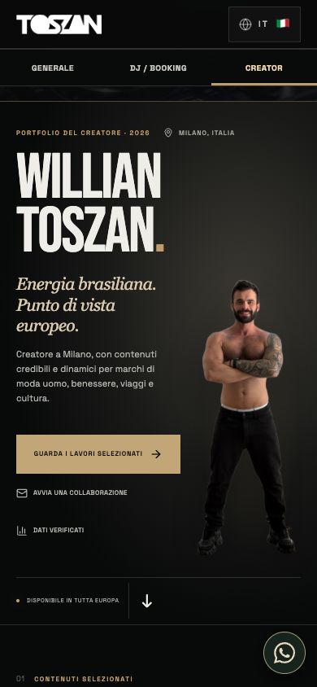
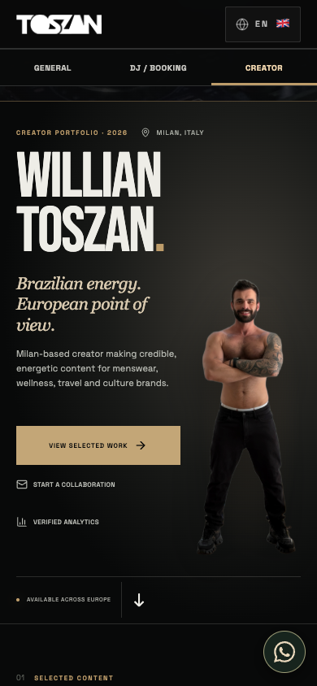
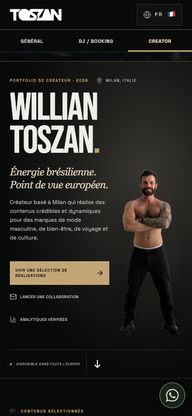

# TOSZAN — correção final de UX e evidências da prévia

Data: 15/10/2026. Implementação concluída e validada na prévia abaixo. Este relatório não representa homologação em iPhone/iPad físicos.

## Identidade exata

- Prévia testada: https://toszan-media-e8w9d1mcr-williangustavosantos-sys-projects.vercel.app
- Deployment: `dpl_8xojaWUFVqi1vRkpCz2fHFvsipym`, READY, ambiente Preview (`target: null`).
- Commit da aplicação testada: `c8633a21c57ef94dfca5c8d7977a7a4916d8cf04`.
- Branch de revisão: `polish/premium-ui-finisher-20261015`.
- Base solicitada: `b5ccd49f3c0aeea617e7b79eb90f208dbf7f6556`, sem alterações pendentes ao iniciar. GitHub sincronizado antes das edições.
- Produção preservada: `dpl_A2RaYN3Bb4CQWnxByjMTv9qZWkJX`, commit `39cfd2fbec1a819d2f408971172dbd27b10e7ead` em `main`. Domínio canônico não promovido.
- O commit posterior de evidências contém documentação e scripts de QA; o código da aplicação é o mesmo do commit testado acima.

## Correções implementadas

| Critério | Correção e verificação |
|---|---|
| DJ e Creator consistentes | `InlineVideo` compartilhado, IntersectionObserver com limiar de 15%, reprodução muda apenas quando visível, pausa fora da área ou quando o card deixa de ser central. |
| Safari/inline | `muted`, `defaultMuted`, `playsInline` e `webkit-playsinline` antes da reprodução. Sem chamada de fullscreen. Todos os 14 arquivos ativos usam H.264/AAC e têm `moov` antes de `mdat` (fast start). |
| Quadros reais | A liberação do pôster depende de quadro/timeupdate. Cada amostra DJ e Creator nos cinco idiomas mede `currentTime` avançando e pixels não pretos mudando em canvas. |
| Som | Toque explícito ativa áudio; apenas uma fonte com som. Troca de vídeo pausa/silencia o anterior. Prévia silenciosa vizinha não é indevidamente interrompida ao ativar outro card. |
| Nove vídeos circulares | Todos preservados; 9→1, 1→9, botões, teclado e eventos de swipe testados. |
| Autoplay bloqueado | Rejeição controlada `NotAllowedError` mantém botão funcional e recupera no toque. Nenhuma tentativa de contornar política. Movimento reduzido e economia de dados respeitados; início manual testado. |
| Quinto Creator | Quatro primeiros em duas colunas; quinto centralizado com a mesma largura. A 390 px, cards de 169 px e centro em x=195. |
| Capa e NOVAFOTO | Mesmo arquivo, sem edições de rosto/corpo. Grid com áreas dimensionadas pelo texto, imagem contida na proporção original; português, italiano, inglês, espanhol e francês sem interseção texto/foto. |
| WhatsApp imediato | Botão na apresentação + um flutuante, ícone reconhecível, área de toque de 52 px, safe area. Destino derivado do contato já cadastrado: `wa.me/393428369444`. Abriu o destino WhatsApp em cada fluxo de idioma sem enviar mensagens. |
| WhatsApp sem obstrução | Posição fixa na lateral procura espaço livre quando coincidir com título, botão, link, vídeo ou iframe. 32 combinações publicadas de largura/seção, zero colisões. |
| Capas musicais | Dez capas originais obtidas com HTTP 200 e incorporadas sem alteração visual ao mesmo domínio. Placeholder de carregamento/erro; espera pela decodificação, camada da imagem acima do placeholder e estado por fonte. Dez seleções e vinte trocas rápidas por idioma. Falha de rede e recuperação testadas. |
| Cabeçalho e âncoras | Altura total medida por ResizeObserver; offset compartilhado. Mobile com barras mais compactas e sem hamburger redundante, mantendo Geral / DJ / Booking / Creator diretamente acessíveis. Âncoras de música, live, Creator, portfólio, métricas e contato verificadas acima do header. |

## Validação da versão publicada

| Ambiente | Cobertura | Resultado |
|---|---|---|
| Google Chrome instalado no Mac, automação com viewports | 320, 375, 390, 430, 768, 820, 1024, 1280, 1440; mobile 844 px de altura, demais 1000 px | 18 verificações geométricas, 27 capturas de capas/áreas; zero overflow horizontal. |
| Playwright WebKit 26.6, emulação mobile/touch | Mesmas nove larguras | Mesma matriz concluída; sem colisão texto/foto. Não equivale a aparelho físico. |
| Chrome + WebKit, idiomas reais | PT, IT, EN, ES, FR, cada um com fluxo completo a 390×844 | Por engine: 45 execuções DJ e 25 Creator, além de wrap, retorno e swipe; tempo/pixels, áudio, WhatsApp, capas, navegação e alinhamento verificados. |
| Perfis iPhone Safari/Chrome, emulados em WebKit | 390×844, touch e user agents correspondentes | Nove clipes + retorno ao primeiro, cinco Creator, som, capa, WhatsApp e ausência de overflow. |
| Perfis iPad Safari/Chrome, emulados em WebKit | 820×1180 e 768×1024 | Mesmos fluxos concluídos. |
| Safari nativo do Mac | Prévia final, início manual inline, botão de som, navegação até 9 e retorno a 1 | Funcionou. O Mac tem `reduceMotion=1`; o início automático fica intencionalmente desativado por essa preferência. |
| Preferências, contextos isolados | Movimento reduzido e saveData | Antes: pausado em 0 s; após toque: reproduzindo silenciosamente com tempo >0,2 s. |
| Autoplay e erro de capa | Rejeição de play e bloqueio de request simulados | Fallbacks funcionais e recuperação comprovada. Simulação não reproduz todas as políticas de iOS Low Power Mode. |

Os dois resultados finais (`final-chrome-qa.json`, `final-webkit-qa.json`) contêm cinco fluxos concluídos, zero falhas, zero exceções JavaScript e zero respostas HTTP de erro do próprio site. A toolbar da Vercel produziu um aviso CORS em uma execução anterior; a origem foi `vercel.live/_next-live/feedback/feedback.js`, não a aplicação, e as duas execuções finais terminaram sem esse erro.

`npm run build` e `git diff --check` passaram. Há um aviso de depreciação de `module.register` na ferramenta instalada; build concluído. `/booking` e `/creator` continuam levando às âncoras corretas; `/analytics` continua acessível. Respostas parciais HTTP 206 e `video/mp4` foram verificadas nos pedidos Range amostrados.

## Evidência visual

As imagens abaixo são capturas da prévia publicada, sem edição. Os JSONs preservam tempos, fontes, pixels, geometria e resultados. Capturas adicionais completas permanecem em `Premium Interactive DJ Website/output/playwright/` no Mac.

- [Primeira tela e WhatsApp](screenshots/final-chrome-390-home.png)
- [DJ reproduzindo com controle de áudio](screenshots/final-chrome-pt-dj-sound.png)
- [Quinto vídeo Creator centralizado](screenshots/final-chrome-pt-creator-last.png)
- [Capas musicais carregadas](screenshots/final-chrome-pt-music.png)
- [Fallback real de interface após autoplay negado](screenshots/final-chrome-autoplay-blocked.png)
- [Fallback de erro de capa](screenshots/final-chrome-artwork-error.png)
- [iPad emulado](screenshots/final-ipad-safari-creator.png)
- [Desktop 1440](screenshots/final-chrome-1440-creator.png)
- [Safari nativo: reprodução inline](screenshots/final-native-safari-dj.png)

### Português

### Italiano

### Inglês

### Espanhol

### Francês

## Limites reais

Nenhum iPhone ou iPad físico foi acessado. Os perfis móveis são emulação, inclusive o Chrome iOS em WebKit; não substituem observação do hardware. Não foi medido som percebido nos alto-falantes de um aparelho físico. O Safari nativo foi observado no Mac com movimento reduzido ativado, portanto a evidência nativa comprova o caminho manual; o autoplay permitido foi comprovado nas execuções Chrome/WebKit sem essa preferência.

O navegador pode negar autoplay por configuração, bateria ou política do dispositivo. O fallback existe para esse caso. Os atributos inline e a necessidade de gesto para som seguem a [documentação de políticas de vídeo do WebKit](https://webkit.org/blog/6784/new-video-policies-for-ios/); arquivos H.264 seguem a [orientação da Apple para vídeo no Safari](https://developer.apple.com/documentation/webkit/delivering-video-content-for-safari).

Produção não foi publicada. A avaliação visual do proprietário no aparelho continua sendo autoridade para uma futura promoção.
